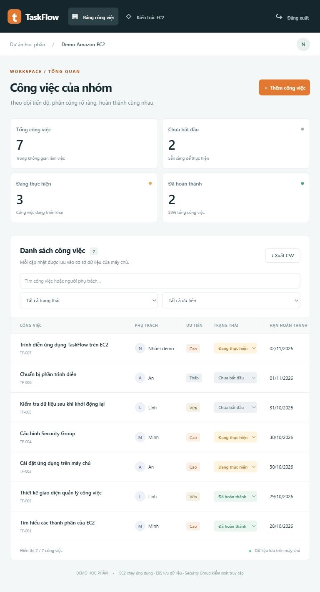

# Amazon EC2 và sản phẩm demo TaskFlow

Bài thực hành tìm hiểu **Amazon EC2**, sau đó triển khai ứng dụng quản lý công việc nhóm. Báo cáo trình bày định nghĩa, thành phần, chức năng, ưu nhược điểm, bảo mật và chi phí trước phần demo. Không sử dụng Amazon S3 trong ứng dụng hoặc quy trình triển khai.

## Sản phẩm

- [Báo cáo Word tiếng Việt 14 trang](Bao_cao_Amazon_EC2_TaskFlow.docx)
- [Slide thuyết trình trên Canva](https://www.canva.com/ai/thread/91c133b6-4447-4d4e-9a3c-ed0168f234f4)
- [Gói ứng dụng chạy được và bộ cài EC2](San_pham_demo_EC2.zip)
- [Hướng dẫn chạy và triển khai chi tiết](ec2-demo/README.md)
- [Kết quả 25 ca kiểm thử](ec2-demo/tests/test-results.json)



## Chạy nhanh từ mã nguồn

Cần Python 3.10 trở lên, không cần thư viện bên ngoài.

```bash
python ec2-demo/app.py --open-browser
```

Trên Windows có thể nhấp đúp `ec2-demo/START_DEMO.cmd`. Mở `http://127.0.0.1:8080/`, đọc phần giải thích EC2 rồi nhập mã cục bộ **demo2026**.

Ứng dụng hỗ trợ thêm, sửa, xóa, đổi trạng thái, tìm kiếm, lọc và xuất CSV. Dữ liệu lưu trong SQLite trên máy chủ. Sau khi khởi động lại tiến trình, người dùng đăng nhập lại và dữ liệu công việc vẫn được giữ.

## Triển khai lên EC2

Dùng Ubuntu Server 24.04 LTS chính thức, một EBS root volume và public subnet. Security Group chỉ cho phép TCP 22 và 80 từ các IP cần dùng; không mở 8080. Sau khi chuyển mã lên máy:

```bash
cd ec2-demo
sudo bash deploy/setup_ec2.sh
```

Bộ cài yêu cầu mã truy cập mới tối thiểu 12 ký tự, cài Nginx, tạo dịch vụ systemd và lưu SQLite trong `/var/lib/taskflow`. Xem hướng dẫn chi tiết trước khi tạo tài nguyên AWS và kiểm tra giá hiện hành.

## Kiểm thử và phạm vi đã xác nhận

```bash
python ec2-demo/tests/test_api.py
```

Đã chạy **25 ca thành công** ở môi trường cục bộ, gồm lưu dữ liệu sau khi tiến trình khởi động lại. Đã thao tác bằng trình duyệt: đăng nhập, thêm công việc, đổi trạng thái, tìm kiếm và xem kiến trúc. Báo cáo Word đã được kết xuất và kiểm tra bố cục 14 trang.

**Chưa tạo hoặc kiểm thử trên EC2 thật.** Bộ cài AWS được cung cấp để người triển khai thực hiện và thu bằng chứng. Nhãn môi trường trong giao diện do cấu hình ứng dụng đặt, không thay thế bằng chứng AWS. HTTP, mã truy cập chung và Python HTTP server tiêu chuẩn phục vụ phạm vi demo; cần bổ sung HTTPS, xác thực, máy chủ ứng dụng và sao lưu phù hợp trước khi dùng thực tế.

## Cấu trúc

```text
ec2-demo/
  app.py
  START_DEMO.cmd
  README.md
  web/
  deploy/setup_ec2.sh
  tests/test_api.py
  tests/test-results.json
Bao_cao_Amazon_EC2_TaskFlow.docx
San_pham_demo_EC2.zip
Giao_dien_demo.jpg
```

Số liệu và tên người trong ứng dụng là dữ liệu minh họa. Không đưa khóa AWS, khóa SSH, tệp môi trường hoặc dữ liệu chạy thực tế lên kho mã.
